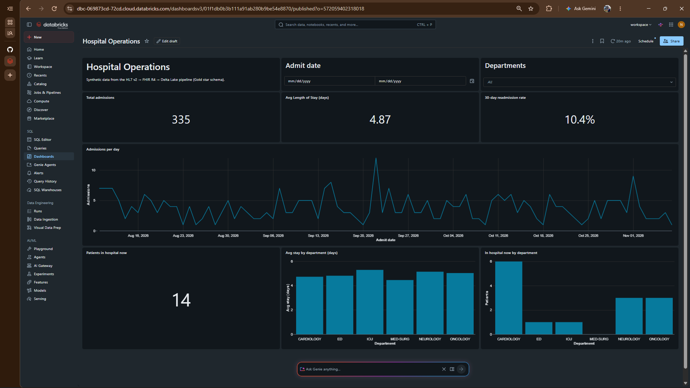
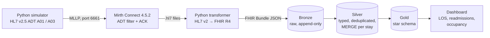
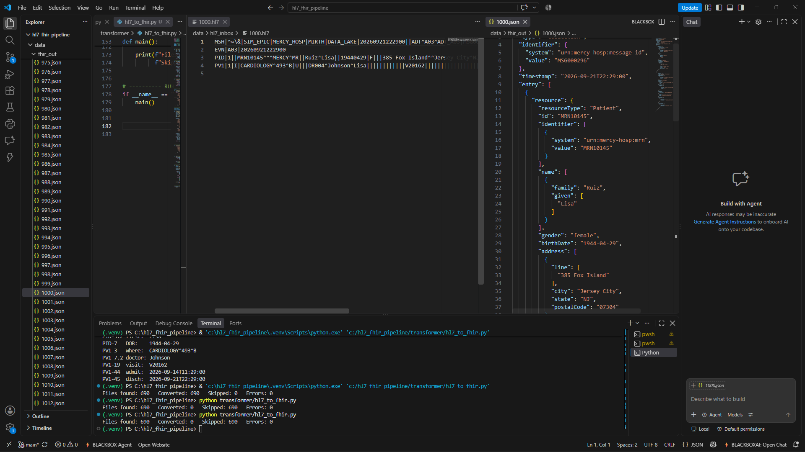
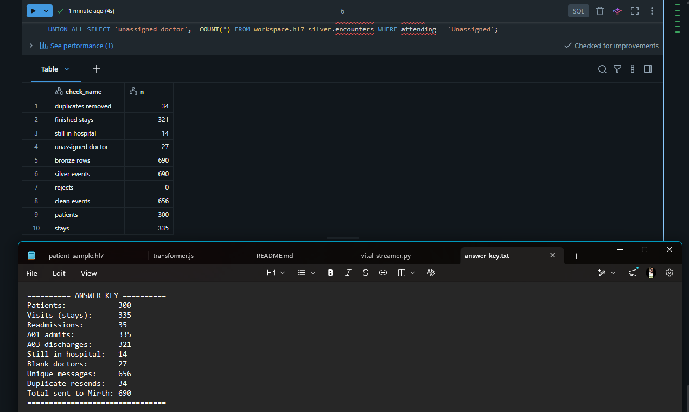

# HL7 v2 → FHIR R4 → Delta Lake: an end-to-end clinical data pipeline

A working healthcare data pipeline that receives hospital admission and discharge messages the way real hospitals send them (HL7 v2 over MLLP into Mirth Connect), converts them to FHIR R4, and lands them in a Databricks Delta Lake medallion architecture that powers a clinical operations dashboard.



## The problem

Hospitals still exchange most patient events as **HL7 v2** messages: pipe-delimited text from the 1980s. Federal interoperability rules (the 21st Century Cures Act and CMS interoperability requirements) now expect data to be shared as **FHIR R4** JSON. Meanwhile, hospital managers need trusted numbers such as **Length of Stay**, **bed occupancy** and **30-day readmission rate**, which affects CMS reimbursement.

This project connects all three: legacy HL7 in, modern FHIR in the middle, analytics-ready Delta tables and KPIs out.

## Architecture



| Step | Tool | What it does |
| --- | --- | --- |
| 1. Simulator | Python, Faker, python-hl7 | Generates 90 days of synthetic admissions (ADT^A01) and discharges (ADT^A03) and sends them over MLLP. Deliberately plants duplicate resends, blank attending doctors and 30-day readmissions. |
| 2. Integration engine | Mirth Connect 4.5.2 | TCP listener in MLLP mode on port 6661. Filters to ADT (`MSH-9.1`), returns an ACK only after the file is written, and saves each message as a file. |
| 3. Transformer | Python | Parses HL7 segments (handling the MSH-1 field offset), maps PID → FHIR **Patient** and PV1 → FHIR **Encounter**, and writes a FHIR R4 Bundle per message. Idempotent, with a dead-letter folder for bad files. |
| 4. Bronze | Databricks, Delta Lake | Stores each bundle as raw text with its source file and load time. Append-only and idempotent via a left anti join. Delta history and time travel for audits. |
| 5. Silver | Spark SQL | Parses JSON into typed columns, quarantines rows that fail quality rules, removes resends by message ID, fills blanks explicitly, and **MERGE**s admissions with later discharges into one row per stay. |
| 6. Gold | Spark SQL | Star schema: `fact_encounters` + `dim_patient`, `dim_location`, `dim_date`. Length of Stay and a 30-day readmission flag computed with a `LAG` window function. |
| 7. Dashboard | Databricks AI/BI | Admissions, average Length of Stay, readmission rate and current occupancy, filterable by date and department. |

## HL7 v2 → FHIR R4 mapping

| HL7 field | FHIR element |
| --- | --- |
| MSH-10 message control ID | `Bundle.identifier` |
| MSH-7 message time | `Bundle.timestamp` |
| PID-3 MRN | `Patient.id`, `Patient.identifier` |
| PID-5 name | `Patient.name.family` / `.given` |
| PID-7 date of birth | `Patient.birthDate` |
| PID-8 sex | `Patient.gender` |
| PID-11 address | `Patient.address` |
| PV1-19 visit number | `Encounter.id`, `Encounter.identifier` |
| MSH-9 event (A01 / A03) | `Encounter.status` (in-progress / finished) |
| PV1-2 patient class | `Encounter.class` (v3 ActCode) |
| PV1-4 admission type | `Encounter.priority` (v3 ActPriority) |
| PV1-3 location | `Encounter.location` |
| PV1-7 attending doctor | `Encounter.participant` |
| PV1-44 / PV1-45 admit / discharge | `Encounter.period.start` / `.end` |



## Results: every layer reconciles to the simulator

The simulator writes an answer key of what it planted. Each layer was checked against it.

| Check | Planted by simulator | Found in Databricks |
| --- | --- | --- |
| Messages received by Mirth | 690 | 690 Bronze rows |
| Duplicate resends | 34 | 34 removed in Silver |
| Unique messages | 656 | 656 clean events |
| Blank attending doctors | 27 | 27 set to `Unassigned` |
| Patients | 300 | 300 |
| Hospital stays | 335 | 335 |
| Discharges (A03) | 321 | 321 finished stays |
| Still in hospital | 14 | 14 |
| 30-day readmissions | 35 | 35 (rate 10.4%) |
| Quality-rule rejects | 0 | 0 |
| Orphan keys in the star schema | — | 0 |

Average Length of Stay: **4.87 days**.



## Design decisions

| Decision | Why |
| --- | --- |
| **Mirth Connect instead of Kafka** for ingestion | Mirth understands HL7 natively (segments, MLLP framing, ACKs) and is what hospitals actually run beside Epic and Cerner. A general message broker would need all of that rebuilt. |
| **ACK after destinations complete** | Mirth only acknowledges once the file is safely written. An early ACK followed by a crash would lose the message silently. |
| **Lakehouse (Delta Lake)** | FHIR is nested JSON, discharges must update earlier rows (MERGE), raw history has to be kept cheaply for years, and audits need point-in-time versions (time travel). |
| **Bronze keeps raw text** | Bronze is the permanent record. Parsing happens in Silver, so a parsing bug never damages the source data. |
| **Quarantine, not delete** | Rows failing quality rules go to `adt_rejects` with a reason, so bad data is visible and fixable. |
| **MERGE on visit ID** | The A03 discharge arrives days after the A01. MERGE updates the existing stay instead of creating a second row. |
| **Star schema in Gold** | Dashboards ask "by department, by day, by age group". One fact table joined to small dimensions answers that simply and fast. |
| **Synthetic data, seeded** | No real patient data is ever used. `random.seed(42)` makes every run reproducible, so the simulator doubles as an answer key. |

## Problems found and fixed

- **Mirth wrote file names instead of messages.** The File Writer template held the file-name pattern, so 690 files contained only their own names. Mirth reported success, so only inspecting the file contents caught it.
- **Bronze read 60,660 rows instead of 690.** PySpark's `.text()` default `wholetext=False` overrode an earlier option and split each file into lines. Caught by reconciling the count before anything was written.
- **`MED-SURG` broke location parsing.** The department name contains a hyphen, so splitting `MED-SURG-305-A` on every hyphen gave the wrong department. Fixed by parsing from the right with a regular expression.
- **Port 8443 already in use.** A local Mirth installation already held the port, so the project uses that install instead of a second copy in Docker.

## Repository layout

```
simulator/send_hl7.py         HL7 ADT simulator (MLLP sender, --dry-run, answer key)
mirth/ADT_Inbound.xml         exported Mirth channel (import it into your own Mirth)
transformer/hl7_to_fhir.py    HL7 v2 to FHIR R4 transformer
databricks/01_bronze.py       Bronze notebook
databricks/02_silver.py       Silver notebook
databricks/03_gold.py         Gold notebook
dashboard/                    dashboard export (.lvdash.json) and screenshots
docs/                         screenshots used in this README
```

## How to run it

1. **Set up Python:** `python -m venv .venv`, activate it, then `pip install -r requirements.txt`.
2. **Mirth Connect 4.5.2:** import `mirth/ADT_Inbound.xml`, set the File Writer directory to your `data/hl7_inbox` folder, then deploy the channel.
3. **Send messages:** `python simulator/send_hl7.py` (or `--dry-run` to print without sending). The answer key is saved to `data/answer_key.txt`.
4. **Convert to FHIR:** `python transformer/hl7_to_fhir.py`.
5. **Databricks:** create the schemas `hl7_bronze`, `hl7_silver`, `hl7_gold` and the volume `hl7_bronze.landing`, upload `data/fhir_out/*.json` to the volume, then run the three notebooks in order.
6. **Dashboard:** in Databricks, import `dashboard/Hospital Operations.lvdash.json`.

## What I'd add next

- **Auto Loader** in Bronze so new files are picked up incrementally without a manual upload.
- A scheduled **Databricks Job** chaining Bronze → Silver → Gold.
- **FHIR validation** of every bundle, and timezone offsets on timestamps for full FHIR conformance.
- Mirth posting FHIR straight to a **FHIR server** (HAPI FHIR) in addition to the file drop.
- More message types: ADT^A08 (patient update) and ORU^R01 (lab results).

## Data note

All data in this project is synthetic, generated with Faker. No real patient information is used, and the `data/` folder is excluded from the repository.
